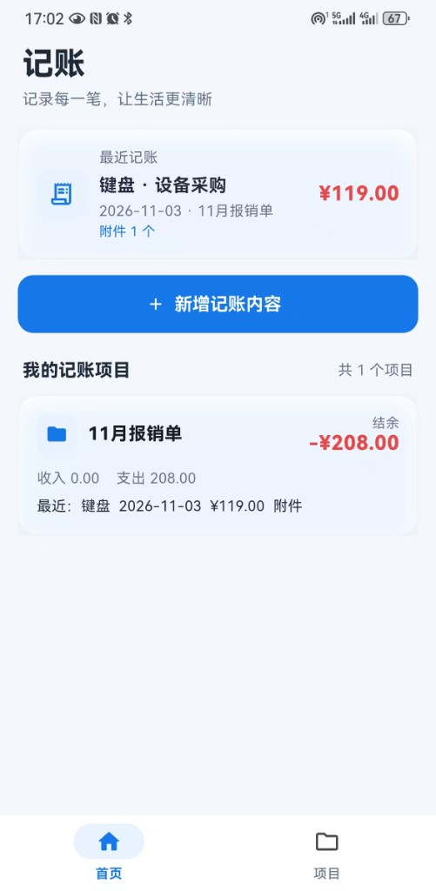
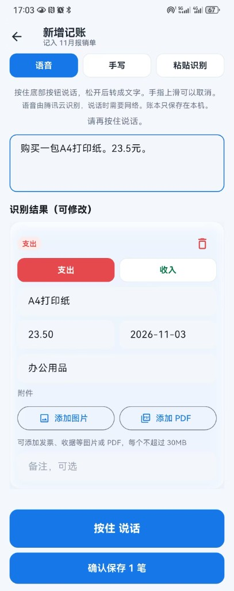
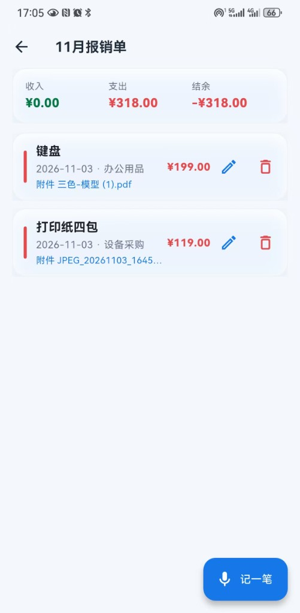
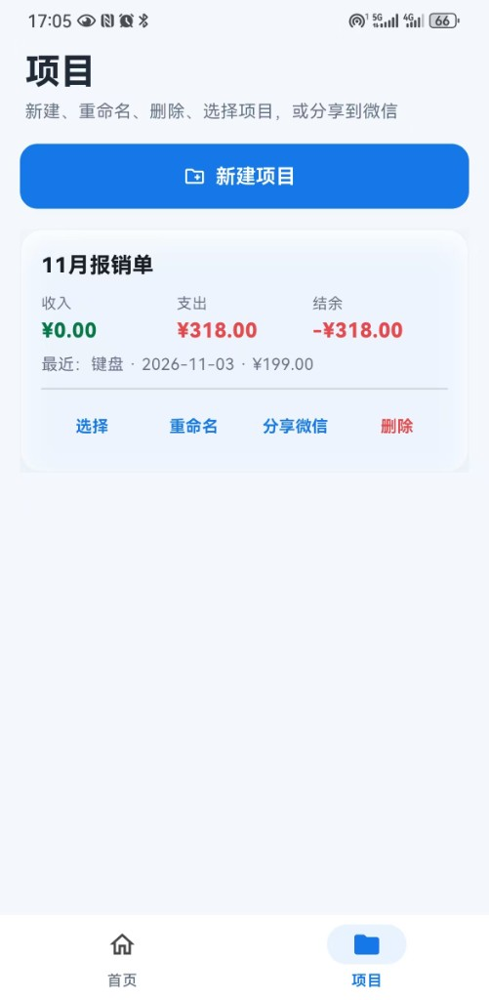
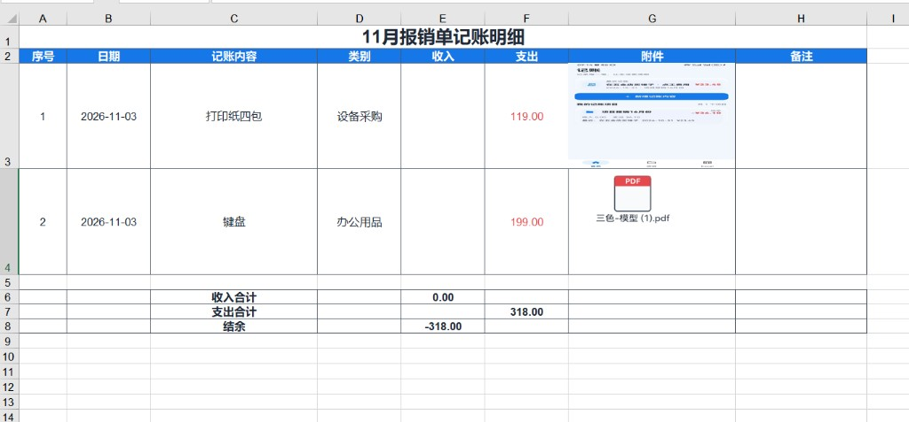

# 记账

本地记账工具。一个记账项目对应一个 Excel 文件，确认保存后自动写入，并计算收入、支出和结余。账本不登录、不上传。语音识别使用腾讯云。

## 截图

| 首页 | 新增记账 | 项目明细 |
| --- | --- | --- |
|  |  |  |

| 项目 | 导出的 Excel |
| --- | --- |
|  |  |

## 界面

底部只有两个入口：

- 首页：最近一笔记账，以及「新增记账内容」。
- 项目：新建、重命名、删除、选择项目。每个项目后面有「分享微信」，直接打开微信选择联系人。

新增记账默认是语音。按住底部按钮说话，松开后转成文字；按住时向上滑再松开，会取消这段语音。语音发给腾讯云「一句话识别」，各型号安卓手机使用同一套服务。也可以改用手写或粘贴识别。粘贴或语音可以一次识别出多笔。日期格式为 `2026-10-30`。识别结果可以修改，确认后才写入。

每一笔记账可以在备注前面添加附件，支持图片和 PDF，可以加多个。文件复制到应用私有目录。分享出去的 Excel 里，图片嵌在附件单元格中。每个 PDF 无论多少页，都作为一个带 `.pdf` 文件名的文件放在同一个附件格里。在 WPS 或 Excel 中双击该文件即可打开。

短时间内重复点击保存不会把同一批记录再写一遍。已经保存的账可以在项目里修改或删除，Excel 合计会跟着重算。

## 数据

账目保存在手机本机数据库。每个项目的 Excel 在应用私有目录，列是：序号、日期、记账内容、类别、收入、支出、附件、备注。附件嵌在单元格里。大标题合并居中，其余内容上下左右居中并带深灰色细框线。收入合计、支出合计和结余使用公式自动求和。

## 安装 Android 版

当前安装包在本机 `release\记账-1.2.15.apk`。把这个文件拷到手机，允许安装未知来源应用后打开安装。已经装过旧版本的手机直接覆盖安装，原来的账会保留。

`release\` 不进入仓库。安装包里编译进了语音密钥，请只留在这台电脑上。

首次使用语音时，请允许麦克风。允许之后松开，再按住说话。识别需要网络，声音会发到腾讯云。账本本身不会上传。

## 开发

```powershell
cd "F:\01 Project\006 CashFlow"
flutter test
flutter build apk --release
```

语音密钥放在 `lib/tencent_secret.dart`，该文件已忽略，不会提交。需要自己新建：

```dart
class TencentSecret {
  static const secretId = '你的 SecretId';
  static const secretKey = '你的 SecretKey';
}
```

iOS 工程保留在 `ios/`。苹果安装包必须在 macOS 上用 Xcode 构建，这台 Windows 电脑无法生成可安装的 `.ipa`。在 Mac 上进入项目目录后执行 `flutter build ipa`。
